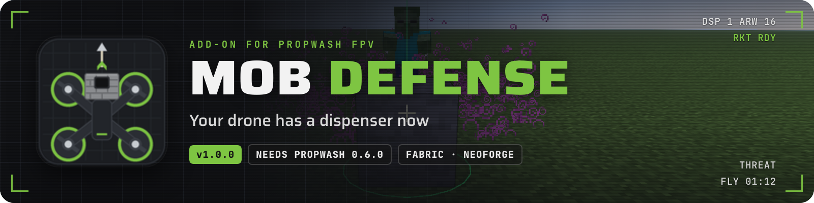
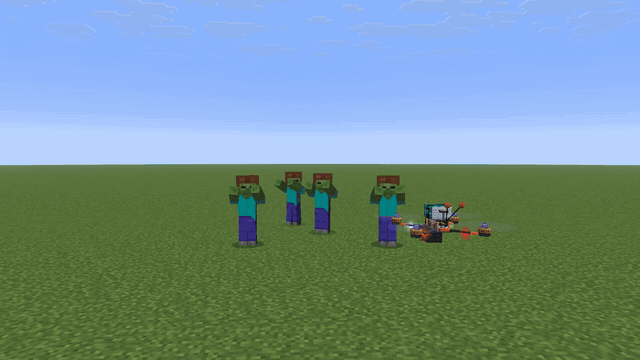
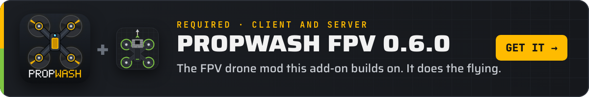
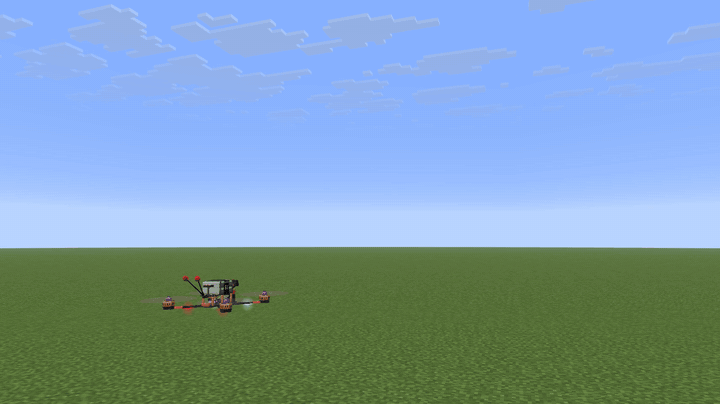
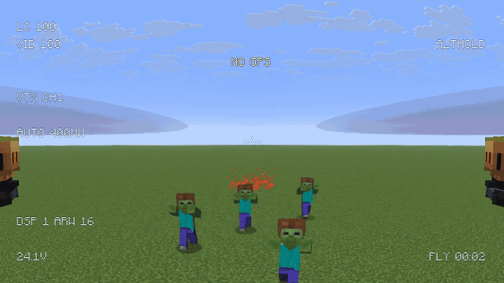
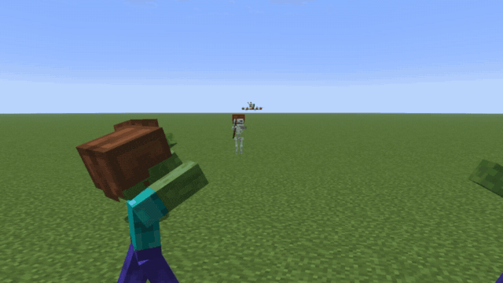

<p align="center"></p>

Version **1.0.0** · Author: lardtom · License: see [License](#license).

**Your drone has a dispenser now.** Mob Defense adds three accessories for Propwash FPV drones: a dispenser mount in
front that fires arrows, potions, wind charges and TNT, a spear mount below that hits mobs in passing, and a rocket
booster on top for an elytra-style boost. And the mobs fight back: zombies come closer, skeletons shoot, phantoms hunt.

<p align="center"></p>

<p align="center"><a href="https://modrinth.com/mod/propwash-fpv"></a></p>

<p align="center"></p>

<p align="center"></p>

Play Propwash with others on our public server **`mc.propwashfpv.com`**. Since Propwash 0.6.0 you can join with
**Fabric or NeoForge**. Add the address to your server list; if the server needs a mod you don't have, the join screen
names it.

<p align="center"></p>

- **Dispenser Mount (front).** Four slots, and it always fires straight ahead: arrows, splash and lingering potions, wind charges, fire charges, TNT and everything else a vanilla dispenser can.
- **Spear Mount (bottom).** One spear, from wooden to netherite. It hits by itself from 4.6 m/s with vanilla spear damage (world rule, 100 % by default).
- **Rocket Booster (top).** One firework rocket gives 2 g along the nose for 1.25 to 2.25 s, like with elytra.

<p align="center"></p>

<p align="center"></p>

- **Real weight.** Every part and every piece of ammo counts. Four potions or four TNT make a 5″ noticeably slower; a 7″ carries them best.
- **Real recoil.** A wind charge pushes a cinewhoop and a 5″ back noticeably, and both stay flyable.
- **Survival recipes.** Made from vanilla items and Propwash's intermediate parts, built on at Propwash's workbench and loaded in the service menu.

The smallest frame with a front mount is the 3″ cinewhoop; the 65 mm whoop only has a bottom mount.

<p align="center"></p>

- **Your trigger, your fire rate.** Fire with *accessory action 1*, best on a button of your radio (Keypad 9 on the keyboard). A short press fires once, holding keeps firing. Set your own fire rate in the configurator tab *Mob Defense*.
- **Slots and booster.** *Accessory action 2* picks the next slot, *accessory action 3* ignites the booster.
- **Everything in the OSD.** Selected slot, ammo and count (`DSP 2 ARW 12`), the booster (`RKT RDY`) and warnings like `NO AMMO`, `TNT LOCKED` or `THREAT`.

<p align="center"></p>

<p align="center"></p>

- **Every hostile vanilla mob reacts its own way.** Zombies are lured and strike low drones, skeletons and pillagers lead their shots, blazes and ghasts fire at you, a breeze blows the drone away, shulker bullets follow it, phantoms circle and swoop, creepers wait under low drones.
- **Watch where you look.** Endermen get angry when your FPV camera looks them in the face, and a creaking freezes under its gaze.

<p align="center"></p>

The wither fires its skulls at drones up to 32 blocks away. An evoker sends fangs under drones that fly low and summons
vexes against higher ones.

Guardians and elder guardians lock their laser onto armed drones like onto players, and shulker bullets make a drone
float up. Mobs only go for drones that are armed or on autopilot, and a mob that is after a player stays on the player. Data packs and other mods can add
their mobs with entity tags.

<p align="center"></p>

- **Three Flight School chapters.** Hold **M** over one of the three parts for *Mob Defense: Dispenser*, *Mob Defense: Spear* and *Mob Defense: Rocket booster*.
- **Four advancements.** *Air Support* (hit another player with a healing potion), *Drone Joust* (defeat a mob with the spear mount), *Afterburner* (ignite the rocket booster) and *Recoil* (fire a wind charge).

<p align="center"></p>

- **World rules in their own section.** Mob reactions on or off, reaction range, mob damage to drones, payloads against players (off by default), TNT (allowed by default), drone griefing, fluid buckets (off by default), real ammo, dispenser cooldown and spear damage.
- **The server decides every shot.** Spawn protection, adventure mode and vanilla PvP are respected. Healing potions always heal, so you can fly air support for your teammates.

A player without the add-on gets a clear message with name and version instead of an error.

<p align="center"></p>

1. Put Mob Defense next to **Propwash FPV 0.6.0** into the `mods` folder (Fabric or NeoForge), on the server and on
   every client.
2. Take the three parts from the add-on's creative tab, or craft them. The recipes unlock as soon as you have one of
   the ingredients.
3. Build them on at Propwash's **Drone Workbench**: dispenser in front, spear below, booster on top.
4. Place the drone, sneak and right-click it and press **Accessories** in the service menu. Load ammunition, a spear
   and one firework rocket.
5. Fly as usual and fire with **accessory action 1**.

<p align="center"></p>

- Minecraft 26.3 · Fabric (Loader 0.19.5+, Fabric API) or NeoForge 26.3 · Java 25
- [Propwash FPV](https://modrinth.com/mod/propwash-fpv) **0.6.0** or newer, on the server and on every client
- Works with [Just More Parts](https://modrinth.com/mod/propwash-just-more-parts) and [Camera Drones](https://www.curseforge.com/minecraft/mc-mods/propwash-camera-drones). A drone carries either a gimbal or the dispenser on its front mount. The parts travel in Propwash's share codes; ammunition doesn't.
- English and German

<p align="center"></p>

<p align="center">

[](https://discord.gg/bNhkSXYSgZ) [](https://propwashfpv.com) [](https://ko-fi.com/propwashfpv)

</p>

Questions, clips of your best volley? Join the Discord or read the docs on the website. Propwash and its add-ons are
free; if you enjoy them, you can support the project on [Ko-fi](https://ko-fi.com/propwashfpv). Thank you!

## Documentation

- Player guide: [`docs/guide.md`](docs/guide.md) (English), [`docs/guide.de.md`](docs/guide.de.md) (German)
- Changes for players: [`CHANGELOG.md`](CHANGELOG.md)
- Store texts: [`docs/modrinth/`](docs/modrinth/)
- Tests: [`docs/testing.md`](docs/testing.md), web export: [`docs/web-export.md`](docs/web-export.md), modules:
  [`docs/dispenser.md`](docs/dispenser.md), [`docs/spear.md`](docs/spear.md), [`docs/booster.md`](docs/booster.md),
  [`docs/mob-reactions.md`](docs/mob-reactions.md), [`docs/osd-ux.md`](docs/osd-ux.md),
  [`docs/core-data.md`](docs/core-data.md) (German)
- Design: [`docs/design.md`](docs/design.md), conventions: [`docs/CONVENTIONS.md`](docs/CONVENTIONS.md) (German)

## Build

Propwash FPV must be in the local Maven repository first (in the Propwash repository: `./gradlew publishToMavenLocal`);
the version is `propwash_version` in `gradle.properties`. JDK 25.

```
./gradlew build
```

`build` compiles Fabric and NeoForge, runs the JUnit tests and checks with `:common:checkPortable` that the portable
cores (`*/core`) compile with Java 21 without Minecraft. The data package for the website and the web configurator:
`./gradlew webExport` (writes `build/web-export/`).

## License

Code under PolyForm Shield 1.0.0 with additional permissions ([`LICENSE`](LICENSE)), documentation under MIT
([`LICENSE-MIT`](LICENSE-MIT)), see [`NOTICE`](NOTICE). The namespace `propwash` belongs to Propwash; this add-on uses
`mobdefense`.

Made by lardtom. NOT AN OFFICIAL MINECRAFT PRODUCT. NOT APPROVED BY OR ASSOCIATED WITH MOJANG OR MICROSOFT.
